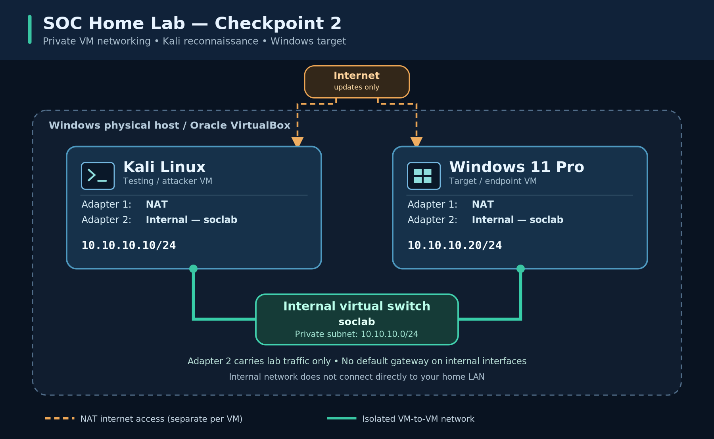
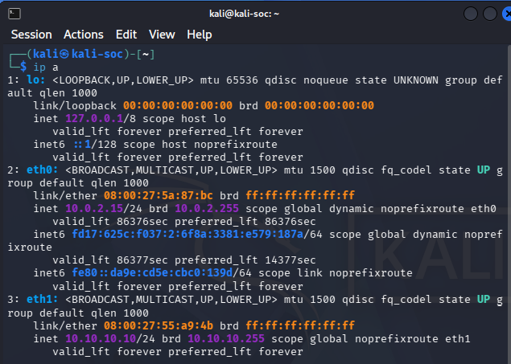
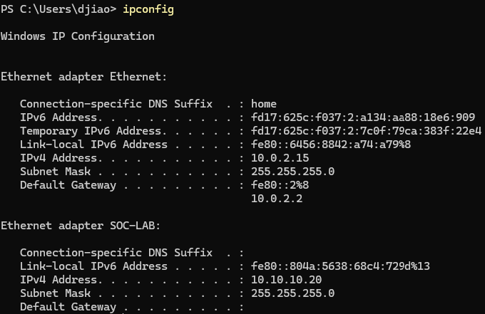
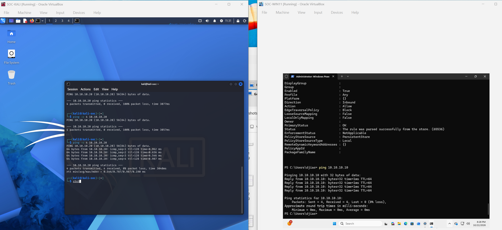
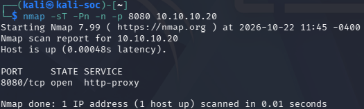
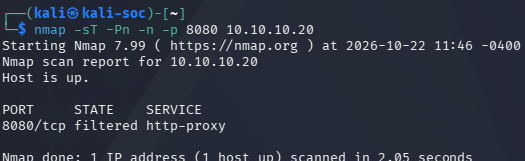

# Checkpoint 2 - Virtual Environment Setup

## Objective
Build a controlled cybersecurity lab using VirtualBox, Kali Linux, and Windows 11. Verify private network connectivity and perform a basic Nmap scan against the Windows VM.

## Lab Environment
Hypervisor: Oracle VirtualBox 7.2.22
Attacker VM: Kali Linux 2026.2
Target VM: Windows 11 Pro 26H2
Kali lab IP: 10.10.10.10/24
Windows lab IP: 10.10.10.20/24
Lab network: Internal Network (soclab)
Internet access: Separate NAT adapters

## Network Design
The VMs share a private internal network for testing. NAT adapters provide outbound access for software updates. The internal interfaces have no default gateway.

## Configuration and Testing
1. Installed and configured both VMs.
2. Assigned static IP addresses to their lab interfaces.
3. Verified connectivity with ICMP ping.
4. Ran an Nmap scan against the Windows VM.
5. Tested a temporary TCP listener on port 8080 on Windows VM.
6. Saved VM snapshots.

## Evidence
- Network adapter configuration:  
- Ping test: 
- Nmap (open port):  
- Nmap (filtered port): 

## Results
- Windows to Kali ping: Pass
- Kali to Windows ping: Pass
- TCP 8080 with listener running: Open
- TCP 8080 after disabling listener: Filtered