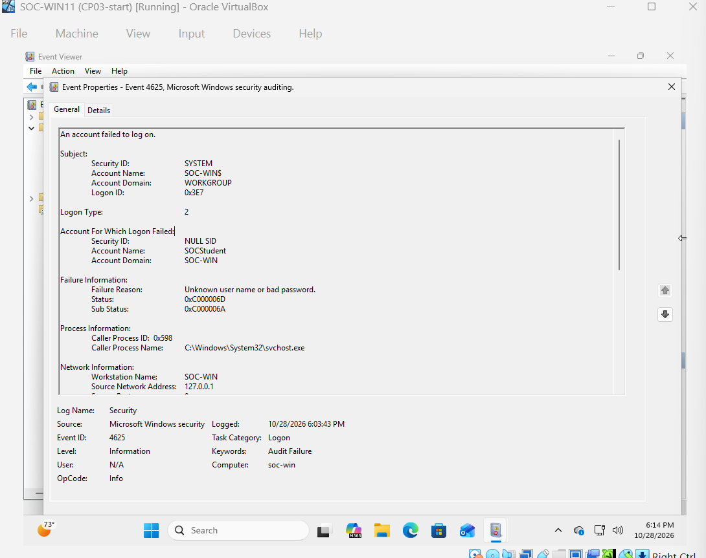
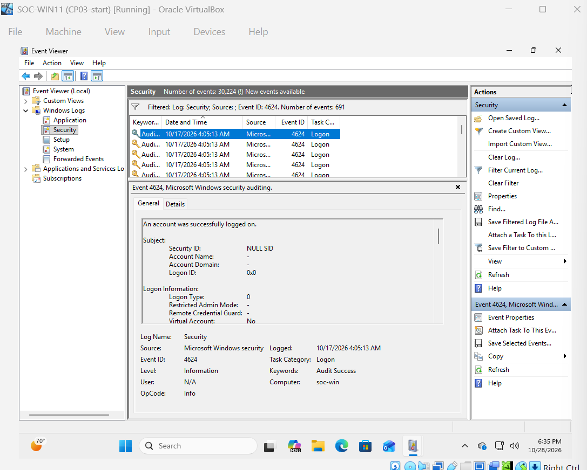
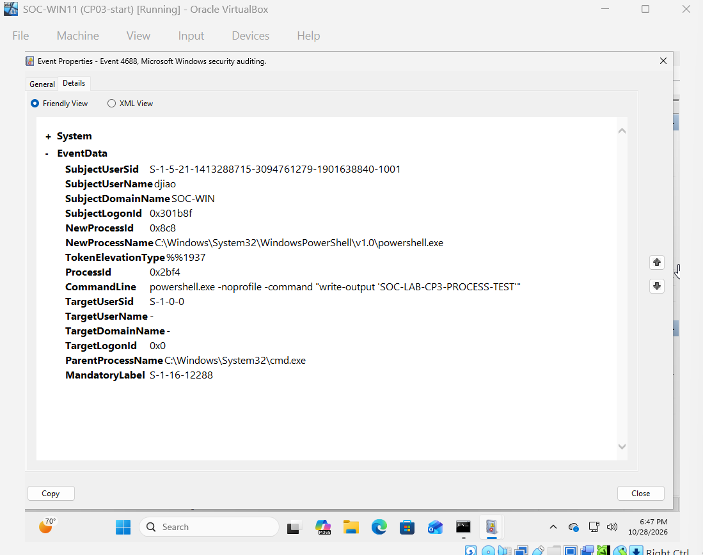
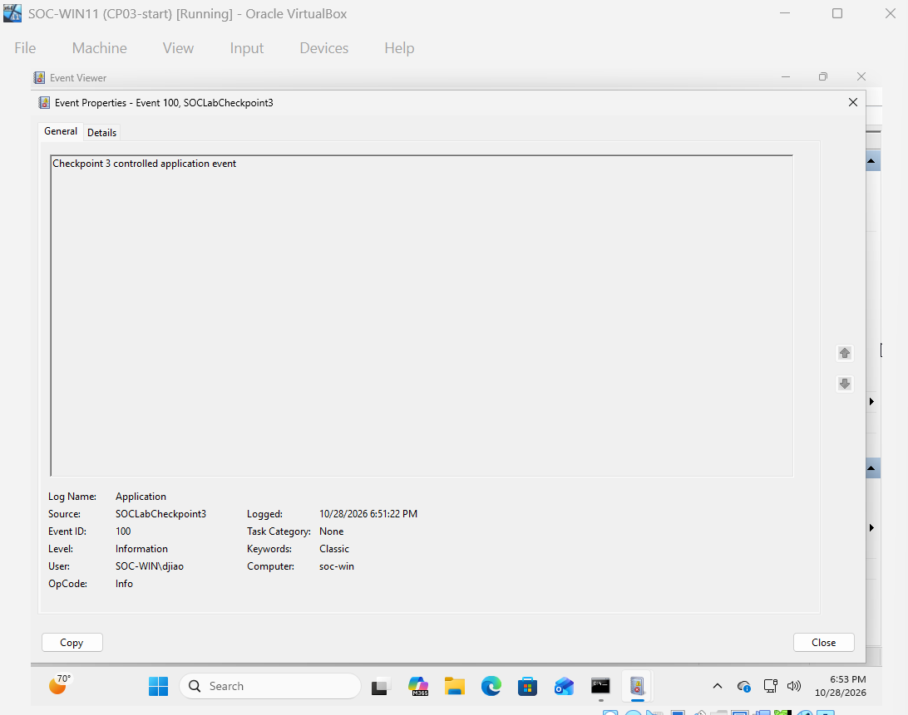
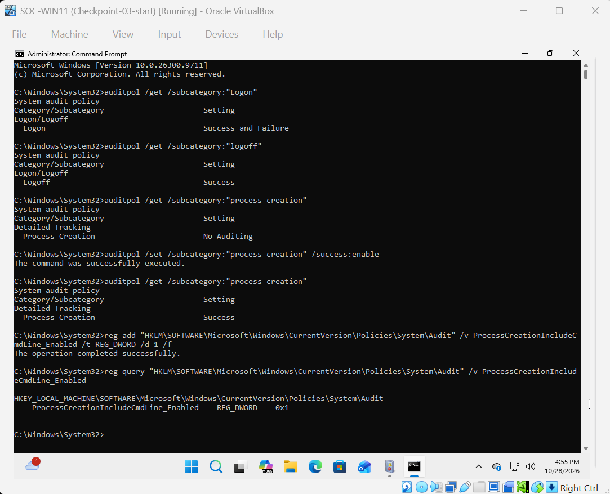

# Checkpoint 3 - Windows Event Log Investigation

## Objective
Investigate Windows event logs before utilizing Sysmon and Splunk.

## Lab Environment
- Windows version: Windows 11 Pro 26H2
- VM hostname: soc-win
- Test accound: SOCStudent

## Configuration and Testing
1. Explored the Application, Securty, and System logs in Windows Event Viewer.
2. Enabled audit policies for login, logoff, procress creation, and process command-line.
3. Generated an unsuccessful login attempt using the SOCStudent account.
4. Authenticated successfully using the same account.
5. Signed out to generate logoff activity.
6. Executed PowerShell commands to generate process creation events.
7. Generated a custom informational event in the Application log.
8. Filtered and examined the resulting Windows events.

## Evidence
- Failed authentication event: 
- Successful authentication event: 
- Powershell process creation: 
- Crafted application event: 
- Audit policies: 

## Results and Findings
- Failed authentication: Event 4625; provides details including targeted account, failure reason, and login type.
- Successful authentication: Event 4624; provides similar details.
- Process execution: Event 4688; provides visibility into process creation. It can show commands used to launch process when command-line auditing is enabled.
- Application event: The custom test demonstrated how an application event can be generated and corresponding event information.

