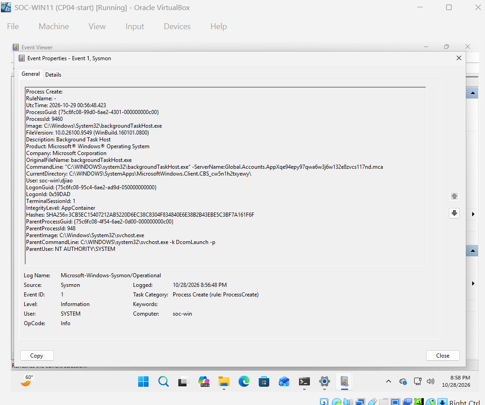
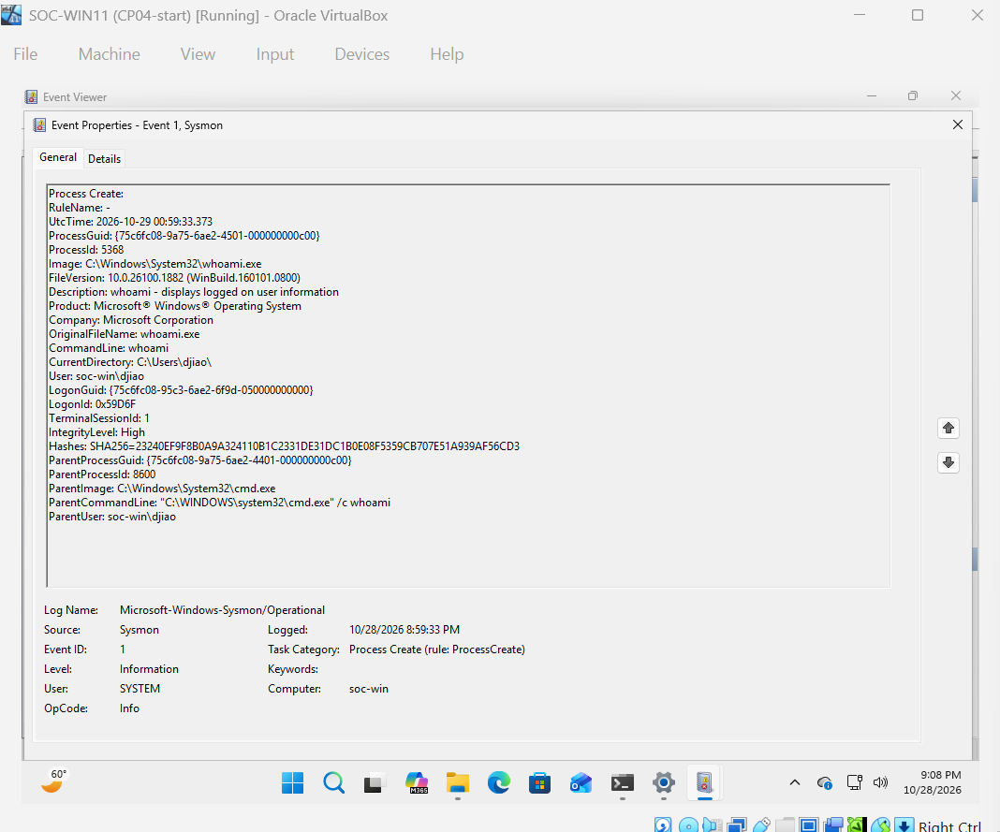
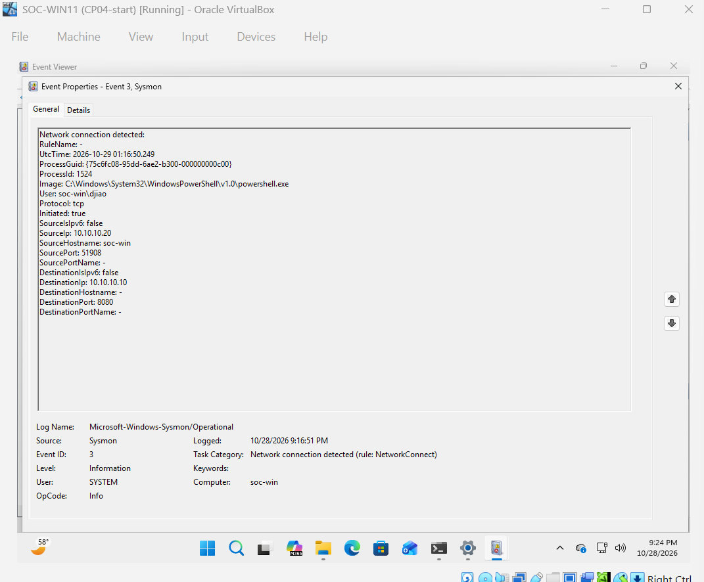

# Objective
Install and configure Microsoft Sysmon on the Windows VM. Generate normal process and network activity, then investigate Sysmon Event IDs 1 and 3 to understand the additional visibility Sysmon provides.

## Lab Environment
- Windows VM: Windows 11 Pro 26H2. IP-10.10.10.20/24
- Kali Linux VM: Kali Linux 2026.2. IP-10.10.10.10/24
- Lab network: Internal network (soclab)
- Internet access: Separate NAT adapters
- Sysmon version: 15.22

## Configuration and Testing
1. Downloaded Sysmon from Microsoft and extracted the installed files.
2. Created and applied a configuration to collect process creation and network connection events.
3. Verified the Sysmon service and Operational event log.
4. Ran cmd.exe /c whoami and opened Notepad both via PowerShell to generate process creation activity.
5. Examined Event ID 1 for process, command-line, user, and parent-process details.
6. Started a temporary HTTP server on Kali VM using TCP port 8080 and connected from Windows VM.
7. Examined Event ID 3 for the initiating process of connection, source/destination IP addresses, and ports.
8. Saved VM snapshots.

## Evidence
- Sysmon installation event log: 
- Process creation event: 
- Network connection event: 

## Results and Findings
- Sysmon installed and sysmon service running.
- Sysmon Operational log: Confirmed to provide detailed endpoint activity.
- Process creation: Event ID 1; process=whoami.exe, commandline=whoami, parent process=cmd.exe.
- Network connection: Event ID 3; initiated=true; source IP=10.10.10.20 (Windows VM), destination IP=10.10.10.10 (Kali VM), destination port=8080.
- Native Windows Event ID 4688 provides process creation information when auditing is enabled. Sysmon Event ID 1 adds fields such as ProcessGuid and executable hashes. Event ID 3 associates network connections with processes.