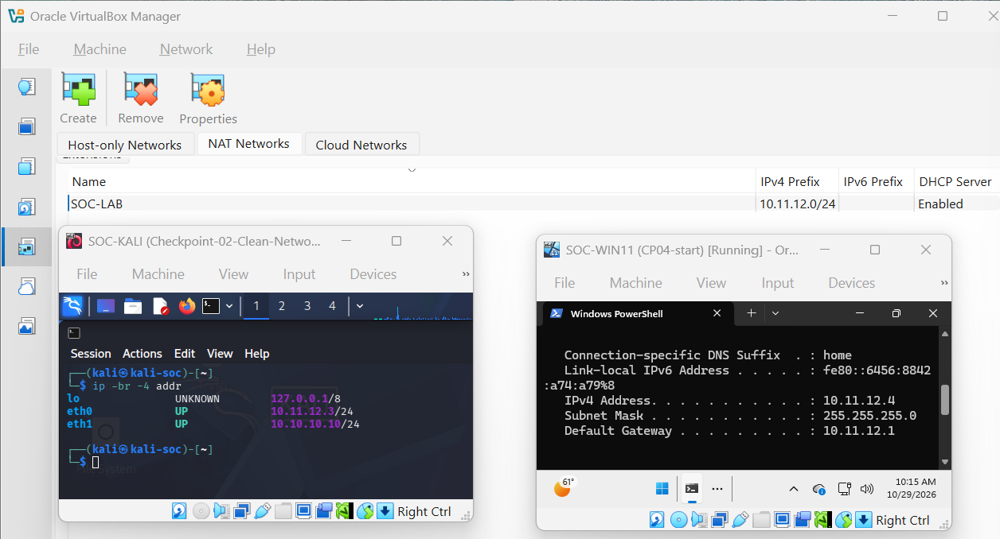
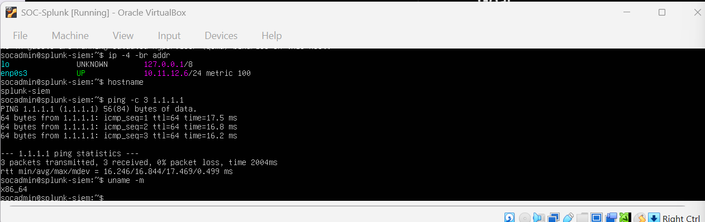
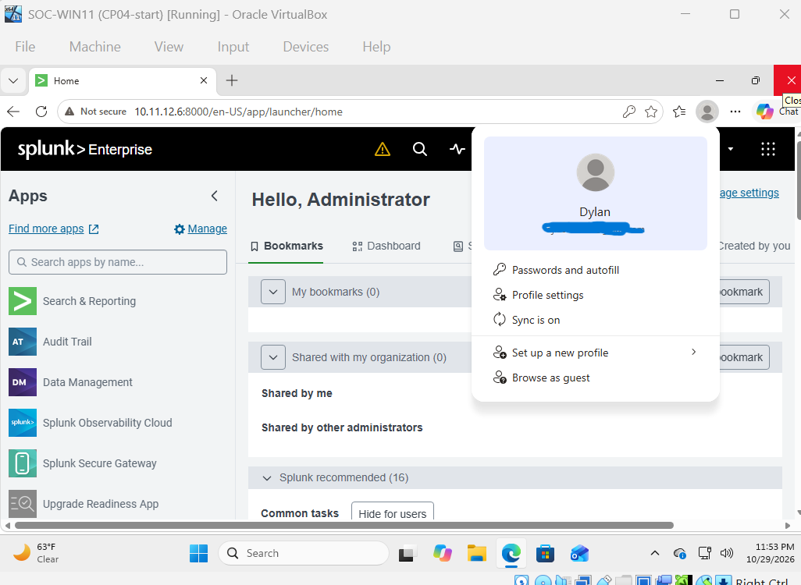
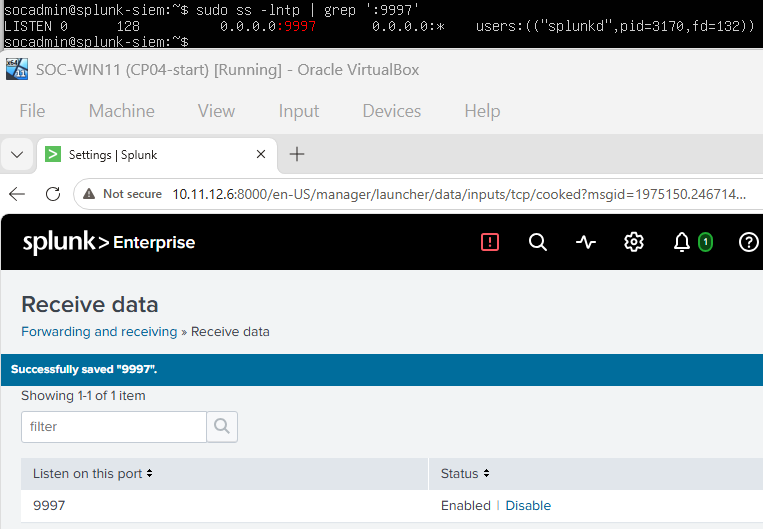
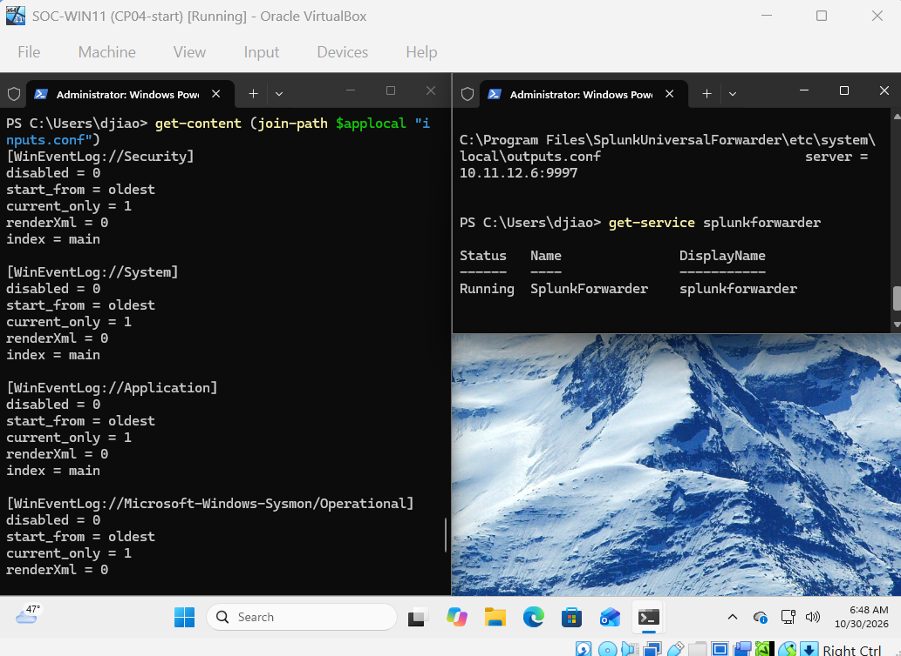
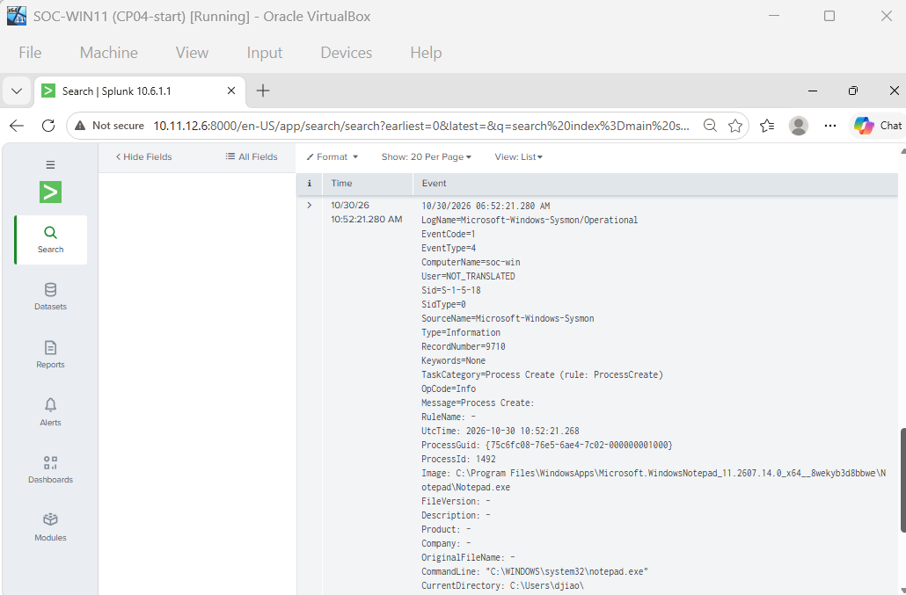
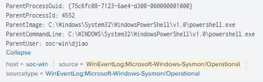

# Objective
Deploy Splunk Enterprise as a centralized SIEM, configure Windows event collection, and verify that Windows and Sysmon events are successfully indexed and searchable in Splunk.

## Lab Environment
- SIEM software: Splunk Enterprise 10.6.1.1
- SIEM server VM: Ubuntu Server 26.04.1
- Windows VM for endpoint telemetry: Windows Pro 26H2
- Software for enhanced endpoint telemetry: Sysmon 15.22
- Collection agent: Splunk Universal Forwarder 10.6.1.1
- Splunk Web: TCP 8000; forwarding receiver: TCP 9997

## Network Design
Updated network configuration:
- Lab subnet: 10.11.12.0/24
- Splunk server IP: 10.11.12.6/24
- Windows VM IP: 10.11.12.4
- Receiving port on SIEM server: TCP 9997
- Splunk web interface port: TCP 8000
The Windows VM endpoint collects operating system and Sysmon events via Splunk Universal Forwarder. Collected events transfer to Splunk Enterprise on Ubuntu server VM, listening on port 9997.

## Configuration and Testing
1. Updated and verified all VMs to share the lab network.
2. Installed and updated Ubuntu Server and installed Splunk Enterprise.
3. Started Splunk and verified access to Splunk Web on TCP 8000.
4. Enabled Splunk's receiving port on TCP 9997 and tested connectivity from Windows VM.
5. Installed Splunk Universal Forwarder on Windows VM and verified its service is running.
6. Configured and verified inputs.conf to collect Security, System, Application, and Sysmon Operational events into main. Verified with btool.
7. Generated a custom Windows Application event and located it in Splunk.
8. Opened Notepad and located and reviewed its Sysmon process creation event.
9. Verified that Windows Security events are searchable and the SPL searches below.
10. Saved VM snapshots.

## SPL Searches
1. Identifying data by host, source, and sourcetype: "index=main | stats count by host source sourcetype | sort -count"
2. Confirming the custom Event ID 900 message reached Splunk: "index=main source="WinEventLog:Application" "Checkpoint 5 forwarding test""
3. Finding events that represent new processes: index=main source="WinEventLog:Microsoft-Windows-Sysmon/Operational" (EventCode=1 OR EventID=1)"
4. Investigating an executed process using Sysmon event: "index=main source="WinEventLog:Microsoft-Windows-Sysmon/Operational" "notepad.exe""
5. Reviewing collected Windows event IDs: "index=main source="WinEventLog:Security" | stats count by EventCode | sort -count"

## Evidence
- Lab network update: 
- Splunk Enterprise on Ubuntu Server VM: 
- Splunk browser interface and receiver port:  
- Windows forwarder: 
- Sysmon process creation event in Splunk:  

## Results and Findings
- Splunk Web: TCP 8000, Pass
- Splunk receiving port: TCP 9997, Pass
- Universal Forwarder service and configuration: Verified
- Sysmon Event ID 1/Notepad execution in Splunk: Found
- Windows Security events in Splunk: Found
- Event pipeline: Windows and Sysmon create events -> Universal Forwarder collects and sends them to Splunk -> Splunk indexes them for searches and analysis.